<picture>
  <source media="(prefers-reduced-motion: reduce) and (max-width: 600px)" srcset="assets/faysal-hero-still-mobile.svg">
  <source media="(prefers-reduced-motion: reduce)" srcset="assets/faysal-hero-still.svg">
  <source media="(max-width: 600px)" srcset="assets/faysal-hero-mobile.svg">
  
</picture>

  <strong>B.Sc. Computer Science student at AIUB · Expected 2027</strong> 
  Systems analysis · databases · data analysis · web development

## About

I am a final-year Computer Science student interested in turning business requirements into useful software. My focus areas include systems analysis, database-backed applications, data analysis and web development.

## Featured work

<picture>
  <source media="(prefers-reduced-motion: reduce) and (max-width: 600px)" srcset="assets/project-highlights-still-mobile.svg">
  <source media="(prefers-reduced-motion: reduce)" srcset="assets/project-highlights-still.svg">
  <source media="(max-width: 600px)" srcset="assets/project-highlights-mobile.svg">
  
</picture>

- [CattleMart](https://github.com/faysalnoob/CattleMart) — C# cattle buying and selling platform.
- [AIUB Token Management System](https://github.com/faysalnoob/AIUB-Token-Management-System) — PHP-based university token management.
- [Portfolio source](https://github.com/faysalnoob/faysalnoob.portfolio) — portfolio website project.

## Research contribution

<picture>
  <source media="(prefers-reduced-motion: reduce) and (max-width: 600px)" srcset="assets/research-flow-still-mobile.svg">
  <source media="(prefers-reduced-motion: reduce)" srcset="assets/research-flow-still.svg">
  <source media="(max-width: 600px)" srcset="assets/research-flow-mobile.svg">
  
</picture>

I co-contributed to a study analyzing 183 valid survey responses using Python, pandas, SciPy and scikit-learn. [Research repository](https://github.com/faysalnoob/Unnoticed-Disclosure-Readers-Do-Not-Register-AI) · [Analysis source](https://github.com/faysalnoob/Unnoticed-Disclosure-Readers-Do-Not-Register-AI/blob/main/src/analysis.py)

The linked repository contains the highlighted working manuscript; it does not claim publication or peer review.

## Languages and applications

  

  
  
  
  
  
  

- **Systems:** requirements analysis, systems analysis and design, SDLC, object-oriented programming
- **Data analysis:** data cleaning, interpretation and basic statistical analysis

<strong>Education and other projects</strong>

### Education

**B.Sc. in Computer Science** — American International University-Bangladesh (AIUB), 2023–2027 expected.

### Coursework projects

- **UniHub:** campus marketplace and rental platform using HTML, CSS and JavaScript.
- **Smart Blind Stick:** sensor-based assistive project with obstacle and water detection plus vibration and voice alerts.
- **Village Scenario:** C++ and GLUT computer-graphics project.

### Training

**AI Engineering Bootcamp** — Ostad, 2025.

### Career interests

Systems analysis, business analysis and junior software development.

## Connect

[GitHub](https://github.com/faysalnoob) · [LinkedIn](https://www.linkedin.com/in/faysal-alam-sa)
